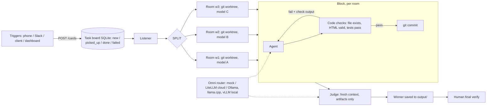

# Software Factory (prototype)

Agentic engineering harness: triggers -> task board -> listener -> SPLIT into parallel rooms (git worktrees), each with a different model -> agent block -> deterministic checks -> retry with feedback -> judge in fresh context -> winner saved -> human final verify.
Principle: move from probabilistic (model) to deterministic (code). Pure Python stdlib, zero dependencies (Playwright only for the screenshot).

## Run (one command)
```
python3 run.py --demo          # dashboard at http://localhost:8787, demo card queued
python3 run.py --demo --once   # headless: process the board and exit
```
Trigger from anywhere (phone shortcut, Slack webhook, client form):
`curl -XPOST localhost:8787/cards -d '{"title":"Landing page","source":"slack"}'`

## Architecture


## Files
- `run.py` entrypoint. `config.json` models, split workers, judge, retries.
- `factory/router.py` omni router: any OpenAI-compatible endpoint plus mock; auto-registers every Ollama model as `ollama/<name>`.
- `factory/board.py` SQLite task board and block-run log.
- `factory/blocks.py` agent block (with retry loop), deterministic checks, judge block.
- `factory/engine.py` listener, SPLIT fan-out, room creation (git worktree per worker).
- `factory/server.py` + `dashboard.html` live board (1s polling) and trigger API.
- `factory/pipelines.py` demo pipeline `landing_page`.

## Plugging in real models
1. Cloud: run LiteLLM proxy (`pip install 'litellm[proxy]'; litellm --config litellm.yaml --port 4000`) with your Anthropic/OpenAI keys, `export LITELLM_KEY=...`, then set `"split_workers": ["claude-opus","gpt","local-qwen"]` and `"judge": "claude-opus"`.
2. Local: `ollama pull qwen2.5-coder:7b`; the router auto-detects it. llama.cpp (`llama-server --port 8080`) or vLLM (`vllm serve ... --port 8000`) work by adding an entry with that `base_url`.
3. Stronger rooms: replace `make_room()` in `engine.py` with a Docker/E2B sandbox; to use a real coding agent runtime, make the agent block shell out to `opencode run`, `codex exec`, `aider --message` or OpenHands headless inside the worktree.

## Mock vs real
Mock models (default) are deterministic: `mock-opus` writes a full page, `mock-sonnet` a minimal one, `mock-gpt` writes broken HTML first and fixes it after the check feedback (shows the retry loop). `mock-judge` scores structure. Everything else (board, listener, worktrees, parallelism, checks, tests, judge guard, save, dashboard) is real.

## Open source stack (verified via GitHub API, 15 Oct 2026)
| Layer | Repo | Stars | Last push |
|---|---|---|---|
| Router / gateway | https://github.com/BerriAI/litellm | 61.3k | 2026-10-15 |
| Router / gateway | https://github.com/katanemo/plano | 7.1k | 2026-10-07 |
| Router / gateway | https://github.com/Portkey-AI/gateway | 13.2k | 2026-05-25 |
| Learned routing | https://github.com/lm-sys/RouteLLM | 5.6k | 2024-08-10 (stale) |
| Local models | https://github.com/ollama/ollama | 183k | 2026-10-15 |
| Local models | https://github.com/ggml-org/llama.cpp | 131k | 2026-10-15 |
| Local models | https://github.com/vllm-project/vllm | 93.9k | 2026-10-15 |
| Coding agent | https://github.com/anomalyco/opencode | 214k | 2026-10-15 |
| Coding agent | https://github.com/openai/codex | 129k | 2026-10-15 |
| Coding agent | https://github.com/OpenHands/OpenHands | 91k | 2026-10-15 |
| Coding agent | https://github.com/aaif-goose/goose | 55.3k | 2026-10-15 |
| Coding agent | https://github.com/Aider-AI/aider | 49.6k | 2026-05-22 |
| Sandbox | https://github.com/e2b-dev/E2B | 14.4k | 2026-10-14 |
| Sandbox | https://github.com/daytonaio/daytona | 71.5k | archived |
| Orchestration / queue | https://github.com/temporalio/temporal | 23.7k | 2026-10-15 |
| Orchestration | https://github.com/langchain-ai/langgraph | 43.3k | 2026-10-15 |
| Orchestration | https://github.com/openai/openai-agents-python | 30.1k | 2026-10-15 |
| Judges / evals | https://github.com/promptfoo/promptfoo | 26k | 2026-10-15 |
| Judges / evals | https://github.com/confident-ai/deepeval | 18.9k | 2026-10-15 |
| Agent training | https://github.com/microsoft/agent-lightning | 18.7k | 2026-10-09 |
